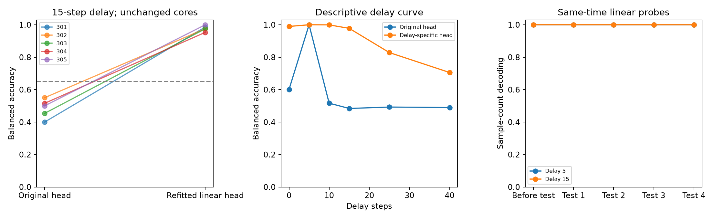

# 分支 B 第一轮：读出救援显著，但质量门槛失败

正式状态：**quality_gate_failed；不裁决 H-B1**。全部五个模型、全部预定延迟和诊断完成，失败对照保留。

| 模型种子 | 15 步原头 BA | 15 步新线性头 BA |
|---|---:|---:|
| 301 | 0.4000 | 0.9858 |
| 302 | 0.5503 | 0.9755 |
| 303 | 0.4537 | 0.9750 |
| 304 | 0.5157 | 0.9530 |
| 305 | 0.5000 | 0.9998 |

主救援均值 0.9778，97.5% t 区间 [0.951029,1.004571]；配对增量 0.49385，区间 [0.391521,0.596179]。t 区间按原式保存，超过 1 的端点不代表可达到的准确率；没有为了结果美观改变统计方法。

标准 5 步原头全部 BA=1。原头清零均值 0.5012；主干与磁盘权重未变，独立重算预测、训练分区标准化、选参和收敛审计通过。

但是，单次训练标签置换对照均值 0.62455，未满足 [0.47,0.53] 质量门槛。该对照仍使用真实验证标签选 C，且模型共享同一次置换；随机对照的设计不能支撑预期的窄随机区间。因此主结果虽超过效果阈值，首轮不能宣告成功。

下一轮由此制定：[B002 对照审计与新图像确认](../../docs/decisions/branch_b/002_from_round1_control_failure.md)。其冻结已有主头，不更换核心或模型，只检验新图像上的结果并修复对照识别问题。

详细输出：[主／次要汇总](../../artifacts/branch_b/round1/summary.json)、[审计](../../artifacts/branch_b/round1/audit.json)、[源码归档](../../artifacts/branch_b/round1/source_snapshot.tar.gz)。

