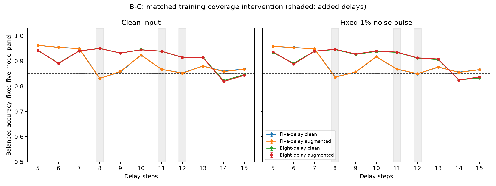

# B-C结案：目标位置改善，但14、15步出现功能缺口

2026-09-25。**H-BC1被限定排除，全部质量门槛通过，首轮后结案。**

**主要发现：增加覆盖使三个目标位置的六项增益全部超过2个百分点，但14、15步的干净／有噪四项区间上界均低于85%。这套流程把部分功能缺口转移到了后段时长，没有完成全部时长修复。**
28项预定要求中，24项支持、4项排除、0项未决。绝对功能22项：18支持／4排除／0未决；目标位置配对增益6项：6支持／0排除／0未决。

## 设计与归因边界

固定五核心，用同批新图像比较五时长基线与加入8、11、12步后的八时长覆盖。四个共享头使用同一个scaler，仅由五个base时长的干净拟合状态计算；每原试次总权重1。四方法均用共同八时长验证规则选C。

干预包含训练时长支持与各时长权重重分配。模型301两个base头选C=10，其余18头选C=100，均在预定网格内；故结论针对整个预定流程，不证明固定C下同样成立。base采用共同八时长验证，是本轮匹配基线，不是历史B-S逐字复制。

成功要求：expanded_aug在全部5–15步干净／有噪22条件BA均>85%，并且三个目标时长六条件相对base_aug均提升>2个百分点。85%是绝对功能保持，不代表其他位置不降分。所有28项区间为99.82142857%双侧t区间，df=19，Bonferroni本轮合计5%错误额度。

## 全时长功能与配对变化

BA为百分比；每库先在模型内平均10次噪声，再平均五模型；干净评价一次，以20个库为推断单位。

| 时长 | 角色 | 基线无噪 | 扩展无噪 | 基线有噪 | 扩展有噪 | 扩展−基线，无噪／有噪（百分点） |
|---|---|---:|---:|---:|---:|---:|
| 5 | 原拟合 | 96.219% | 94.287% | 95.868% | 93.630% | -1.933／-2.239 |
| 6 | 未拟合的已知时长 | 95.404% | 89.030% | 95.300% | 88.805% | -6.374／-6.495 |
| 7 | 原拟合 | 94.920% | 94.002% | 94.859% | 93.896% | -0.917／-0.963 |
| 8 | 新增拟合 | 83.046% | 94.983% | 83.576% | 94.684% | +11.937／+11.108 |
| 9 | 未拟合的已知时长 | 85.873% | 93.164% | 85.647% | 92.776% | +7.291／+7.129 |
| 10 | 原拟合 | 92.351% | 94.450% | 91.737% | 94.006% | +2.099／+2.269 |
| 11 | 新增拟合 | 86.693% | 93.895% | 86.807% | 93.540% | +7.202／+6.733 |
| 12 | 新增拟合 | 85.144% | 91.446% | 84.925% | 91.259% | +6.303／+6.334 |
| 13 | 原拟合 | 88.004% | 91.315% | 87.647% | 90.801% | +3.310／+3.153 |
| 14 | 未拟合的已知时长 | 85.799% | 81.852% | 85.452% | 82.417% | -3.946／-3.035 |
| 15 | 原拟合 | 86.729% | 84.327% | 86.557% | 83.715% | -2.402／-2.843 |

## 三个目标位置的预定改善判据

| 指标 | 配对增益（百分点） | 校正区间 | >2个百分点判据 |
|---|---:|---|---|
| gain_d8_clean | +11.936 | [11.818, 12.055] | 支持 |
| gain_d8_noise | +11.108 | [10.988, 11.227] | 支持 |
| gain_d11_clean | +7.202 | [7.051, 7.353] | 支持 |
| gain_d11_noise | +6.733 | [6.620, 6.845] | 支持 |
| gain_d12_clean | +6.303 | [6.101, 6.504] | 支持 |
| gain_d12_noise | +6.334 | [6.163, 6.505] | 支持 |

## 未满足或未决的完整要求

| 指标 | 均值 | 校正区间 | 门槛 | 裁决 |
|---|---:|---|---:|---|
| absolute_d14_clean | 81.852 | [81.737, 81.968] | 85.0 | 排除 |
| absolute_d14_noise | 82.417 | [82.335, 82.499] | 85.0 | 排除 |
| absolute_d15_clean | 84.327 | [84.235, 84.419] | 85.0 | 排除 |
| absolute_d15_noise | 83.715 | [83.636, 83.794] | 85.0 | 排除 |

绝对指标单位是百分比，增益单位是百分点。任一要求上界低于门槛即可排除合取假设；其他条件的成功不会被抹去。未达到2个百分点也不等于没有任何改善。全部28项区间和440个单模型成绩见[完整结果](FULL_RESULTS.md)。

## 个体、参照与诊断

各模型expanded_aug在22条件中的最低观测均值：301：69.149%；302：78.673%；303：86.073%；304：83.578%；305：77.920%。集合判据不保证每个个体均达到85%。

四种共享头及八个专用增强参照完整保留；专用参照的正对照全部通过，具有多套参数和时长条件资源，不是资源相同的竞争方法。共享干净头为次要参照，不把其与增强头的差异当作增强必要性或等效性结论。每候选逐时长训练／验证损失与BA保留，可用于决定下一项可辨识干预，不在本轮据此更改目标或扩网格。

## 执行与审计

- 20新头、100候选全部完成，验证损失、选参、原试次／时长／噪声权重、共同scaler与梯度均独立重算。最大梯度∞范数为9.48e-08，低于1e-6。
- 拟合／验证各5,000张图像；读出冻结后才生成20个测试库各1,000张。本轮30,000张相互无像素重复，并与B至B-L的160,000张历史图像及A显式库4,000张核查无重复；不涵盖未留存在线训练图像。
- 1,100个模型×库×时长单元全部完成。独立重建全部噪声重复和test续算，复核57,200组线性头预测、原任务头、清零、64次标签置换与64次分层状态错配。审计复用模型定义，不是完全独立软件实现。
- 八个专用参照及原任务头5步的正对照全部通过，下界最低96.954%；负对照均值范围49.955%–50.052%，在47%–53%流程门槛内。这不是等效性证明。
- 42项实现／回归测试通过；28项统计终点另用结果单元与独立区间计算交叉核对。训练先于冻结和测试的顺序、头及核心冻结、历史科学产物完整性通过。当前规划入口的合法更新单独归档，不重写历史清单。
- 每计算进程CPU一线程，最多两个并行。科学条件、数据量与总权重未因资源改变。所有候选、源码、环境、日志与原始预测归档。

## 对下一步有用的诊断

15步已包含在扩展训练中，不能将其失败仅解释为未拟合时长的插值不足。选定增强头的训练／验证混合BA如下（干净／噪声各半；描述性诊断，不是新增确认性检验）。

| 方法 | 15步训练BA | 15步验证BA |
|---|---:|---:|
| base_aug | 86.593% | 86.557% |
| expanded_aug | 83.999% | 83.941% |

扩展头的15步训练与验证表现已约84%，且专用15步参照正常。因此下一步优先考虑固定当前八时长覆盖、共同scaler和噪声定义，对比平均损失与更关注最差时长的目标，检验当前目标的权衡是否限制了功能。该方向尚未执行，失败也可能涉及正则化或共享线性表达限制。若同时把14步加入训练，会混合覆盖和目标两项变化，应单独设臂，不把效果单独归因于目标。

本轮匹配基线在11步已经超过85%，不应把三个历史失败位置都称为本轮基线失败；六项配对增益仍按原要求全部检验。

## 结论边界与停止

推断只针对既有五核心和本次拟合／验证数据；不覆盖新核心或重新拟合的不确定性。5–15步已在历史中观察过，本轮是已知时长的新图像确认；6、9、14步未用于本轮拟合／验证，也不能据此称为从未参与方法开发的新时长。原始t区间未截断，天花板处退化或越界不证明总体无误差。

依据预定合取判据，H-BC1被限定排除，本分支结案。停止不是由耗时、预算、轮数或暂时不显著触发；不将具体流程的失败扩大为共享线性边界数学上不存在。后续应根据本轮功能与逐时长训练／验证诊断另立问题，本次不追加调参以改变结论。

## 复现材料

- [执行前协议](../../artifacts/branch_bc/round1/protocol.md)、[停止决定](../../docs/decisions/branch_bc/BC001_STOP.md)、[完整数值](FULL_RESULTS.md)
- [机器汇总](../../artifacts/branch_bc/round1/summary.json)、[训练审计](../../artifacts/branch_bc/round1/training_audit.json)、[预测审计](../../artifacts/branch_bc/round1/independent_audit.json)、[数据顺序完整性](../../artifacts/branch_bc/round1/data_chronology_integrity.json)
- [最终哈希清单](../../artifacts/branch_bc/reproducibility_manifest.json)

重算现存汇总与图表：scripts/branch_bc_analyze.py、scripts/branch_bc_crosscheck.py、scripts/branch_bc_report.py。完整复制使用独立空输出目录，按prepare→train(301–305)→training审计→lock→prepare_test→evaluate(301–305)→evaluation及integrity审计→analyze/crosscheck/report执行，避免覆盖归档。
