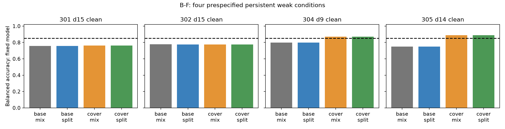

# B-F 最终报告：覆盖修复部分短板，但整体个体恢复假设被排除

2026-09-25。依据工作区最新完成的 B-Z 结果规划，执行前登记后完成一个科学轮次；全部质量检查通过。H-BF1 要求主要候选 cover_split 在五个固定核心、5–15 步和干净／噪声的全部 110 个个体条件下 BA>85%。结果为 **98 项支持、7 项排除、5 项未决**，故按预登记停止规则，限定假设被排除，本分支停止。

这里的“排除”针对本轮完整方法和固定拟合结果，不是证明共享线性读出不存在，也不是因预算或低显著性停止。五项未决保留，不追加测试库改变判定。

## 设计与完整执行

B-Z 发现四个模型的短板经五次重拟合持续存在：301／302 的 15 步已参与拟合，304 的 9 步和 305 的 14 步未参与拟合。本轮用同批数据比较 2×2 因素：八时长或加入 9、14 后的十时长；每时长混合干净／噪声组或分别成组的平滑最大对数损失。温度固定 0.05。主要候选是十时长、条件分组方法。

五个核心完全冻结，每方法共享一个跨时长固定线性头；每模型四臂共用原五时长干净状态拟合的标准化。拟合与验证各 5,000 新图、8,000／2,000 试次；20 测试库各 1,000 新图、2,000 平衡试次。每条件噪声评价 10 重复。共训练 100 候选、选择 20 头，完成 1,100 个模型×库×时长测试单元，全部头冻结后才生成测试数据。

主统计在每个固定模型条件内平均噪声重复，以 20 库为抽样单位。110 项使用双侧 t 区间、df=19、单项置信度 99.954545…%，Bonferroni 本轮总错误额度 5%；不以五模型平均代替个体判据。区间依赖库级 t 近似，限于此次固定拟合。

## 四个预定短板

以下均为 BA%，方法比较是同库配对点估计，未另行登记确认性增益检验。

| 固定条件 | 八时长混合 | 八时长分组 | 十时长混合 | 十时长分组 |
|---|---:|---:|---:|---:|
| 301_d15_clean | 75.700 | 75.645 | 76.287 | 76.242 |
| 302_d15_clean | 77.702 | 77.677 | 77.640 | 77.642 |
| 304_d9_clean | 79.757 | 79.757 | 87.168 | 87.168 |
| 305_d14_clean | 74.988 | 74.988 | 88.965 | 88.965 |

加入覆盖后，304 的 9 步提高 **7.410 个百分点**，305 的 14 步提高 **13.9775 个百分点**，两项主要候选校正下界均超过 85%。但 301／302 的 15 步仍明显失败。条件拆分在这四处的点估计变化仅 −0.055 至 +0.0025 个百分点；这说明本次拆分没有观察到足以修复这些短板的收益，不能解释为统计等效或所有分组目标无效。

覆盖还伴随性能权衡：301 的 6 步干净成绩从匹配基线 77.5875% 降至 68.495%，304 的 7 步干净从 86.7525% 降至 84.845%。6 步没有参与拟合或验证。主要候选五模型平均的最低条件点估计为 84.8812%，但本轮并未为该平均量登记确认性判据。

## 明确失败的七项

| 条件 | BA% | 校正区间% |
|---|---:|---|
| 301_d6_clean | 68.495 | [68.004, 68.986] |
| 301_d6_noise | 68.706 | [68.322, 69.090] |
| 301_d13_noise | 83.523 | [83.120, 83.926] |
| 301_d15_clean | 76.242 | [75.923, 76.562] |
| 301_d15_noise | 78.368 | [78.072, 78.664] |
| 302_d15_clean | 77.642 | [77.494, 77.791] |
| 302_d15_noise | 79.148 | [79.053, 79.244] |

## 未决项与个体最差值

| 未决条件 | BA% | 校正区间% |
|---|---:|---|
| 301_d8_clean | 84.840 | [84.453, 85.227] |
| 301_d8_noise | 85.216 | [84.886, 85.545] |
| 301_d14_noise | 85.116 | [84.871, 85.361] |
| 303_d6_clean | 85.300 | [84.992, 85.608] |
| 304_d7_clean | 84.845 | [84.457, 85.233] |

五模型主要候选的最低条件点估计分别为：301 68.495%、302 77.6425%、303 85.300%、304 84.845%、305 86.511%。点估计超过 85% 本身不等于该模型全部条件得到区间支持。

## 质量、完整性与实现记录

61 项实现／回归测试通过；全部 100 候选独立重算目标、梯度、权重、标准化和选参，最大梯度∞范数 9.292×10⁻⁸。测试复核重构全部噪声重复、57,200 组头预测及清零／置换／分层状态错配；110 主区间和四个目标效应另外从已审计库记录重新聚合。审计复用模型定义，不能称为完全独立软件实现。

正对照校正区间下界最低 96.9148%；全部登记负对照均值范围 49.9570%–50.0423%，通过 47%–53% 流程门槛。负对照通过不是等效证明。新 30,000 张图像相互及相对历史 294,000 张留存图像无像素重复；没有核查未留存在线训练图像。

执行中有实现修复，均留痕：最初依据过期对话误触已完成 B-L 的八个源码／文档／日志文件，数据覆盖保护阻止继续；八文件已逐字节恢复到历史清单 SHA256，未更改旧数据、头或结果，随后才依据最新 B-Z 开始本轮。恢复副本误入首次测试收集、环境版本记录首次误用系统 Python，也分别修复并保留失败日志。

测试数据第 16 库生成时发现一张与留存图像重复的像素图，断言在任何测试评价前停止。保留前 15 库并继续同一图像随机流，在相同数量下拒绝重采样一次替换该图，再完成全部数据核查；不改变配对流、样本量、模型、阈值，未依据成绩筛选。复现须包含此确定性修复步骤。详见[实现记录](../../artifacts/branch_bf/round1/implementation_notes.md)、[恢复记录](../../artifacts/session_recovery_20260925/RECOVERY.md)及 duplicate_rejection.json。

历史 B 至 B-Z 科学文件均按原清单验证；唯一明确排除的条目是历来可变的 NEXT_EXPERIMENT_PLAN.md，旧版本与更新原因单独保存，旧清单未改写。此次已将当前入口更新为 B-F 结案。

## 解释与后续边界

覆盖干预对两个未拟合时长短板有效，但不足以实现全条件恢复，并伴随其他时长退化。干净／噪声拆分未修复两个已拟合时长的严重短板。因此不能继续把全部问题归因于覆盖遗漏或一次拟合波动；同时，本实验没有证明容量瓶颈或共享线性分隔数学上不可能。

四臂均按十时长×两条件最大验证对数损失选 C，故八时长基线也看过 9／14 的验证状态，不能与 B-Z 原流程直接作因果比较。本轮除模型 305 两个八时长臂选 C=1 外，其余均选网格边界 C=100；未追加网格。覆盖同时改变时长基础权重，选 C 也是流程的一部分；改善不可单独归因于纯支持变化。平滑对数损失与最差 BA 并非同一目标。

若之后再开分支，优先检验“当前优化／正则化选择是否牺牲薄弱条件”与“当前状态的共享线性表达是否受限”的区别，需依据本轮完整结果另行登记干预和判据；此次不在观察到结果后扩温度、正则化网格或读出容量。结论不外推新核心、新分布或新时长，也未完成新方法的独立重拟合稳定性验证。

## 复现与文件

在隔离副本和空输出目录中，使用已记录虚拟环境执行 prepare → 五核心 train → training audit → lock → prepare_test（遇已记录重复时执行 resume_data）→ 五核心 evaluate → evaluation audit → analyze → crosscheck → report → interpret → integrity → archive_final。最多两计算进程、每进程一 CPU 线程。保留原数据、100 候选、20 头、原始预测、执行前源码和最终源码快照、环境与失败日志；不要在现有产物上直接重跑。

[执行前协议](../../artifacts/branch_bf/round1/protocol.md) · [110 项完整结果及对照](FULL_RESULTS.md) · [停止决定](../../docs/decisions/branch_bf/BF001_STOP.md) · [机器汇总](../../artifacts/branch_bf/round1/summary.json) · [完整性检查](../../artifacts/branch_bf/round1/integrity.json) · [复现清单](../../artifacts/branch_bf/reproducibility_manifest.json)
