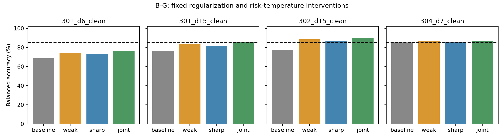

# B-G 最终报告：固定正则化／风险干预修复15步短板，但未实现全时长恢复

2026-09-25。根据B-F完整结果登记并执行一个科学轮次。**H-BG1的八项主判据全部支持，质量检查通过，按预登记规则结案。** 在核心、训练数据和线性容量不变时，C10000、温度0.005的固定联合干预使301、302在15步干净／噪声四项BA均超过85%，相对同库基线的四项增益均超过2个百分点。

这是对这两个固定核心、指定已训练时长和本次固定拟合的支持，不是对全部时长、全部模型或独立重拟合稳定性的支持。301的15步噪声条件主区间下界仅85.0268%，通过余量很窄。

## 为什么做这一轮

B-F表明补充9／14步覆盖可以修复相应短板，但301／302已参与拟合的15步仍失败。B-F五个cover_split头均在C=100的网格边界取得所用验证损失最优值，且改用最小验证BA选参仍不会改变301／302的选择。于是本轮直接改变惩罚强度与风险聚合，而不重复已有覆盖或选参实验。

四臂固定为baseline=(C100,tau0.05)、weak=(10000,0.05)、sharp=(100,0.005)、joint=(10000,0.005)。C增加100倍对应惩罚系数减少100倍；温度减少10倍让较差组损失占更高权重，但仍不是精确最大目标。baseline复用B-F冻结头，其余15头从零拟合，不进行新的C／温度搜索，不按验证或测试选臂。

全部五模型复用B-F同一拟合／验证数据、十时长、20个干净／噪声组、原scaler和噪声尺度，每方法始终是跨时长固定的64维状态线性头，核心不变。6步不参与拟合或验证。全部20头审计冻结后才生成20新测试库，共20,000新图、每库2,000平衡试次，每噪声条件10重复；完整评价5×20×11=1,100单元。

## 主结果

主家族为四项绝对BA和四项配对增益。每个固定模型以20库为单位，噪声先在库内平均10重复；双侧t、df19，8项Bonferroni区间为99.375%，本轮主家族错误额度5%。全部绝对下界>85%、全部增益下界>2个百分点。

| 模型／15步条件 | baseline BA% | joint BA% | joint主区间% | 配对增益pp | 增益主区间pp |
|---|---:|---:|---|---:|---|
| 301/clean | 76.133 | 85.708 | [85.2308, 86.1842] | 9.575 | [9.222, 9.928] |
| 301/noise | 78.213 | 85.261 | [85.0268, 85.4947] | 7.047 | [6.849, 7.246] |
| 302/clean | 77.650 | 90.045 | [89.7616, 90.3284] | 12.395 | [12.084, 12.706] |
| 302/noise | 79.244 | 88.687 | [88.4389, 88.9356] | 9.443 | [9.226, 9.661] |

四因素臂在两个15步干净短板上的描述性结果如下。单独减弱正则化或降低温度均有改善，joint的点估计最高；这不是对两个因素必要性、统计交互或唯一机制的确认性检验。

| 条件 | baseline | weak | sharp | joint |
|---|---:|---:|---:|---:|
| 301_d15_clean | 76.133 | 83.758 | 81.703 | 85.708 |
| 302_d15_clean | 77.650 | 88.538 | 87.185 | 90.045 |

## 完整矩阵和副作用

次要110个joint个体条件采用另一个110项Bonferroni描述性家族：104项下界>85%，4项上界<85%，2项未决。它与主家族不声称联合5%错误覆盖，不能替代已登记的八项主判据。

明确失败均集中在未拟合／未验证的6步：

| 条件 | joint BA% | 110项描述性区间% |
|---|---:|---|
| 301_d6_clean | 76.315 | [75.744, 76.886] |
| 301_d6_noise | 76.632 | [76.193, 77.072] |
| 304_d6_clean | 82.172 | [82.041, 82.304] |
| 304_d6_noise | 82.102 | [81.980, 82.224] |

301/6步/干净从基线68.5475%提高到76.315%，仍不够；304/6步/噪声则从89.92225%降至82.102%，退化7.82025个百分点。302/6步也出现下降。因此，本轮修复确实伴随跨时长权衡，不能只报告成功条件。

未决项为301/15步/噪声和303/6步/噪声。前者在预登记主8项家族下下界85.0268%，但在更宽的次要110项家族下下界84.9390%；差别来自不同预登记校正家族，并非更换主判据。后者次要区间为[84.7288%,85.6412%]。

此前两个覆盖短板没有丢失：304/9步/干净从同库基线87.1875%升至94.095%，305/14步/干净从88.970%升至92.445%。所有个体和条件的四臂成绩、全部正负对照及优化诊断均在完整结果表，不用模型平均掩盖失败。

## 质量、独立复核与数据

63项实现／回归测试通过。15新头及5基线头全部独立重算20组风险、目标、梯度；最大梯度∞范数8.841×10⁻⁸。复核训练／验证原状态、四次噪声、scaler来源和100个前向一致性检查，无拟合或数值失败。

评价复核从图像编码重新写出sample、blank-delay、test递推，重建全部噪声重复、57,200组头预测、原头预测和reset预测；64标签置换与64test数量内状态错配另行循环核对。它复用模型参数与编码定义，不是完全独立的软件或物理实现。118个主／次区间及主分类从已审计库记录再次独立聚合。

正对照区间下界最低96.9623%，负对照整体均值范围49.9345%–50.0730%，全部通过登记门槛；负对照不是等效证明。全部20,000新图与324,000张历史留存图及彼此像素不重复，本轮拒绝重采样计数为0，不涵盖未留存在线训练图像。

历史B至B-F科学文件按原清单验证；当前可变规划入口是明示例外，旧入口已归档，旧清单未改写。所有新头与开发输入在测试前冻结，冻结后源码／参数／输入哈希核查通过。原始图像、配对、预测、清零预测和逐库置换索引均保留；确定性广播复制的预测不冗余保存，状态从像素重新构建。本轮没有删减旧工件。

审计代码编写阶段补齐空白输入线性层偏置，并在执行前加入重构测试；无根据结果修改模型、阈值或协议。实现说明、初始源码快照和最终源码快照均归档。

## 解释、停止与下一问题

结论支持：此前两个15步短板至少可以通过固定读出优化流程改变来修复，不能把它们解释成必须增加状态或线性读出容量才能越过的障碍。它不证明正则化或温度是唯一原因，不证明两因素都必要；本轮也没有比较所有可能目标或证明共享线性边界的全条件存在性。

本轮复用既有训练／验证图像，独立性来自新的测试库；不能称为对新训练抽样的重拟合复现。所有时长历史已知；6步只是在本拟合流程中留出，不能称作真正未知时长。置信区间依赖库级t近似，并条件化于固定五核心和生成分布。

H-BG1获支持后按原规则停止，不追加库提高余量或事后扩大主结论。若再开分支，应优先区分6步缺口是否来自未覆盖与跨时长优化权衡，并对窄余量的15步修复做独立重拟合检验；这些尚未执行，不预定其结果。

## 复现

在隔离副本和空输出目录中，保留B-F开发输入及历史依赖，按history → train五模型 → audit_train（含全局冻结）→ prepare → evaluate五模型 → audit → analyze → crosscheck → report → interpret → archive执行。使用归档环境，最多两计算进程、每进程一CPU线程。当前已完成输出不要原地覆写。执行前协议不修改，当前规划入口与完成标记另存。

[执行前协议](../../artifacts/branch_bg/round1/protocol.md) · [完整结果](FULL_RESULTS.md) · [停止决定](../../docs/decisions/branch_bg/BG001_STOP.md) · [机器汇总](../../artifacts/branch_bg/round1/summary.json) · [独立审计](../../artifacts/branch_bg/round1/independent_audit.json) · [复现清单](../../artifacts/branch_bg/reproducibility_manifest.json)
