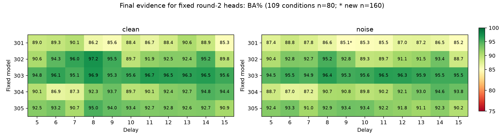

# B-H 最终报告：补齐6步后，独立新拟合的全110条件获得限定支持

2026-09-26。**连续执行三轮，每轮依据上一轮完整结果预登记。最终达到“限定确认假设获支持”的停止条件，分支结案。** 对第二轮固定的新拟合读出，五个固定核心、5–15步、干净／既定1%噪声共110个条件的最终区间下界均超过85%。

最窄余量为301/9步/噪声：85.095375%，最终区间[85.020874%,85.169876%]。它只比85%高出约0.0209个百分点的下界余量。不能据此声称任意重拟合、新核心或新分布都稳定成功。

## 三轮如何由结果驱动

| 轮次 | 结果依据与动作 | 完整结果 | 为什么继续／停止 |
|---|---|---|---|
| 1 开发覆盖干预 | B-G的301/304在未拟合6步失败；只补入6步，保留C10000、tau0.005及容量 | 110项106支持、0排除、4未决 | 6步改善，但没有独立新拟合证据且4项未决；登记新拟合确认 |
| 2 独立新拟合确认 | 根据第一轮窄余量，十／十一时长两头均在新fit/validation从零拟合，固定80新测试库 | 109支持、0排除、1未决：301/9/noise | 未满足停止规则；保持头不变，登记剩余项的独立精度确认 |
| 3 剩余项独立确认 | 根据唯一未决项，固定160全新库；旧109项收紧区间，新目标分配单独额度 | 新目标下界85.020874%>85%；最终组合110项全部通过 | 限定主假设支持，停止；不是按轮数、耗时或预算停止 |

第一轮和第二轮的“未决”记录保持原样。第三轮没有改阈值、训练权重、模型或第一／二轮原报告，也没有把新测试库追加到旧样本后套普通区间。

## 干预和数据

核心301–305冻结，每个方法跨时长使用单一固定64维状态线性头，不输入时长标签。ten使用原十时长，eleven加入6步，其他C10000、tau0.005、组风险、噪声尺度与读出容量不变。增加时长同时改变组的基础权重，因此结果不能归因于纯支持变化而排除权重重分配。

第一轮复用B-F开发图像与scaler，ten复用B-G joint，eleven五头新拟合；用20新库完整检查。第二轮fit/validation各5000新图、8000/2000平衡试次，两方法共享各模型从原五时长干净拟合状态得到的新scaler，共10新头，无选参，80新测试库。第三轮不拟合，逐参数复制第二轮301两头；160新库评价9步目标及5／15步对照。

三轮所有测试库均每库1000图、2000试次，每噪声条件10重复。所有训练头在任何相应新测试图生成前审计冻结。测试与拟合数据隔离，全程无C、温度、特征、阈值或测试样本量搜索。

## 第二轮配对干预的具体结果

以下是同批新拟合和新测试数据上的BA%，差异为描述性配对点估计，不新增机制增益主判据。

| 条件 | ten | eleven |
|---|---:|---:|
| 301/6/clean | 76.1956 | 89.3144 |
| 301/6/noise | 76.5969 | 88.7674 |
| 304/6/clean | 82.1156 | 86.8506 |
| 304/6/noise | 82.1042 | 87.0364 |
| 301/15/clean | 85.7312 | 85.3200 |
| 301/15/noise | 85.3642 | 85.1867 |
| 302/15/clean | 89.8081 | 89.8125 |
| 302/15/noise | 88.7331 | 88.7366 |

6步缺口在新的拟合数据上也明显改善；15步修复保留，但301的余量仍小。未进行统计等效或两个因素必要性检验，不能把基线与候选的每个点差都当作已确认机制效应。

## 最终统计为何没有靠反复追加获得通过

第二轮原主家族使用110项Bonferroni总alpha=.05，其结果是109通过、1未决。第三轮开始前，先对**第二轮全部110项**使用更严格的alpha=.025/110、df79重新计算，109项仍通过。这使基于旧数据选择剩余项受到旧110项同时覆盖事件的保护；完整旧区间冻结于bridge.json。

唯一剩余目标301/9/noise使用160完全独立的新库，库内平均10噪声重复，双侧t、df159、alpha=.025，得到97.5%区间。旧110项同时覆盖的失败概率≤.025，新固定目标覆盖的失败概率≤.025；由并集界，最终110项组合结论的错误额度≤.05，依赖库级t近似。此5%不追溯涵盖全部历史分支、全部对照或额外描述性比较。

新旧库不合并，160样本量和目标在看到新测试成绩前固定，模型与scaler不改变。第三轮只是同一第二轮拟合实例的精度确认，不是第三次独立拟合。

## 五个模型各自最弱的最终区间

| 模型 | 最低下界对应条件 | BA% | 最终区间% |
|---|---|---:|---|
| 301 | 301_d9_noise | 85.0954 | [85.0209, 85.1699] |
| 302 | 302_d15_noise | 88.7366 | [88.5718, 88.9014] |
| 303 | 303_d5_noise | 94.5469 | [94.3826, 94.7112] |
| 304 | 304_d6_clean | 86.8506 | [86.6397, 87.0616] |
| 305 | 305_d15_noise | 90.2281 | [90.0629, 90.3932] |

109项采用80库的收紧区间，301/9/noise采用160新库区间，单项置信水平不同，均已在最终完整表标明。所有条件均是逐个固定模型评估，未用五模型平均掩盖失败。

## 审计和复现

最新65项实现／回归测试通过，前两轮分别为63／64项。两轮共15新拟合头、5复用基线，第三轮无训练。训练目标、组风险、scaler、梯度和验证逐项复算，最大审计梯度∞范数约2.442×10⁻⁸。

三轮共5980测试单元、179080组头预测独立重构；每次噪声、reset、原头预测、64标签置换和64test数量内状态错配均核对。第一轮110区间、第二轮110区间、第三轮旧110收紧区间及1新目标区间分别重新聚合。审计复用模型参数和编码定义，不是完全独立的软件或生物学实现。

三轮正对照区间下界最低分别96.9446%、97.0029%、98.0574%；负对照总范围49.9555%–50.0495%、49.9774%–50.0218%、49.9714%–50.0763%，全部通过登记门槛。负对照是流程检查，不是等效证明。

新增270000张图像与344000张历史留存图及彼此无像素重复，累计核查614000张；三轮拒绝重采样次数均为0。未保存的在线训练图像不在核查范围。全部原始图像、配对、预测、reset预测和逐库置换索引保存；状态通过像素重建，不冗余保存，不删旧工件。历史科学文件按原清单验证，唯一明示可变项为当前规划入口，其旧版本已保存。

80库独立区间复算代码在执行统计前修正过方差分母括号，并新增样本量回归测试；没有根据结果修正方法或样本量。各轮协议、配置、执行源码哈希、锁定时间、环境、日志、完整结果及最终源码快照归档。环境沿用既有虚拟环境，最多两计算进程，每进程一CPU线程。

复现应在隔离副本与空输出目录完成，不能原地覆盖现有工件。第一轮：history→train→audit_train→prepare→evaluate→audit→analyze→report。第二轮使用BH_ROUND=2的bh2版本：prepare_fit→train→audit_train→prepare→evaluate→audit→analyze→report。第三轮使用bh3版本：锁定原第二轮头及bridge→prepare→evaluate→audit→analyze。每轮都先读其协议；第三轮桥接计算只用第二轮完成结果。最后interpret与complete封存。

## 停止与边界

按预登记的H-BH2最终组合判据，全部110项下界>85%，满足用户约定的“限定假设获得支持”停止条件。没有继续扩大时间范围、改核心或新增头容量，也不以极窄通过余量宣称普遍稳健。

本轮给出了固定五核心上、第二轮这一独立新拟合的完整覆盖共享线性读出实例。第一轮开发数据上的全条件证据仍未完全确定；本分支未估计任意重拟合的成功率或尾部失败概率。所有时长已在历史开发中观察，eleven全部时长都参与拟合，不是未知时长泛化。合成任务的恢复也不证明真实乌鸦NCL的机制。

[最终110项区间](FINAL_RESULTS.md) · [第一轮](round1/FULL_RESULTS.md) · [第二轮](round2/FULL_RESULTS.md) · [第三轮](round3/FULL_RESULTS.md) · [停止决定](../../docs/decisions/branch_bh/BH003_STOP.md) · [完整性审计](../../artifacts/branch_bh/final_integrity.json) · [复现清单](../../artifacts/branch_bh/reproducibility_manifest.json)
