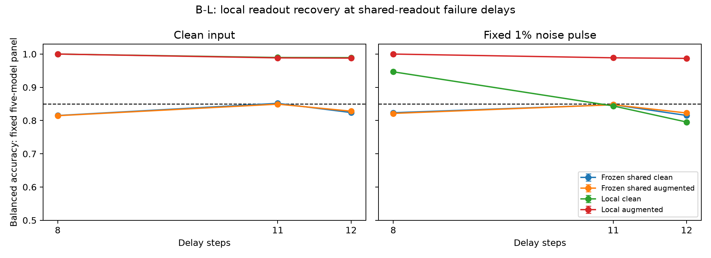

# B-L实验结案：共享头失败位置的专用线性功能可以恢复

2026-09-25。**H-BL1在预定范围内获得支持，六项主条件与全部质量门槛通过，首轮后结案。**

冻结301–305五核心，仅为8、11、12步分别拟合线性读出后，三个时长的干净和原1%噪声条件均恢复到85%功能门槛以上。六项99.166667%双侧t区间的下界全部通过，最低为98.668%。

该结果说明这些已知失败位置的状态仍能被本次专用线性流程有效利用；旧共享头失败不能直接归结为状态不含可用任务信息。专用头需要按时长选择参数及标准化器，本轮没有修复共享头，也没有验证未见时长泛化。

## 主要结果

BA为20个新测试库上的固定五模型集合均值。每库先平均各模型10次噪声重复，再平均五模型；干净只评价一次。

| 时长 | 专用增强头无噪BA | 99.166667%区间 | 专用增强头有噪BA | 99.166667%区间 |
|---|---:|---|---:|---|
| 8 | 99.999% | [99.998%, 100.001%] | 99.998% | [99.996%, 100.000%] |
| 11 | 98.850% | [98.795%, 98.904%] | 98.868% | [98.827%, 98.910%] |
| 12 | 98.779% | [98.749%, 98.810%] | 98.695% | [98.668%, 98.722%] |

六项采用Bonferroni合计5%错误额度，df=19，依赖库级抽样和t近似。推断条件化于固定五核心、一次拟合／验证库和最终读出，不覆盖重新拟合或新核心种子的变异；更多图像库不是更多独立模型。保留未截断区间，天花板附近的退化或越界不能解释为总体无误差。

## 同库对照与个体差异

| 时长 | 原共享增强头无噪／有噪 | 专用干净头无噪／有噪 | 专用增强头相对共享头提升（无噪／有噪，百分点） |
|---|---:|---:|---:|
| 8 | 81.454%／82.140% | 99.999%／94.657% | +18.545／+17.858 |
| 11 | 84.930%／84.751% | 98.960%／84.388% | +13.920／+14.117 |
| 12 | 82.820%／82.273% | 98.925%／79.550% | +15.959／+16.422 |

上述配对差异是预定次要描述；专用头与旧共享头使用不同拟合库、参数数量及标准化，不能单独归因为训练时长覆盖。专用干净头用于区分无噪可读性与增强作用，不将其表现包装成增强必要性或唯一机制证明。

各模型在六项主要条件中的最低观测均值：301：99.994%；302：99.983%；303：99.881%；304：97.190%；305：96.424%。这些个体点估计不代替模型群体推断。四种头的全部120个单模型×时长×输入条件成绩及拟合诊断见[完整结果](FULL_RESULTS.md)。

## 执行与审计

- 30个新头、150个候选全部完成。独立重算标准化、权重、候选验证损失、选参和梯度；最大梯度∞范数为9.7e-08，低于1e-6。全部30头选C=100，位于预定网格上界；未扩网格或测试调参。
- 拟合／验证各5,000张图像；30头冻结后才生成20个测试库、每库1,000张，共30,000张新图像。数量、配对频数、标签、边际和不同图像检查通过。
- 新图像跨分区无像素重复，并与五个B系列分支130,000张历史图像及A阶段明确保存的4,000张外形库图像无重复。A阶段66个NPZ数组已检查维度；不声称排除了未留存在线训练图像的全部重复。
- 完成300个主要单元与200个锚点单元。独立重新构造全部噪声重复及4步test续算，复核15,400组线性头预测、原任务头、清零预测、64次标签置换及64次分层状态错配；全部通过。审计复用模型定义与视觉缓存函数，不是完全独立的软件实现。
- 原任务头5步、B-N增强头15步的两输入条件均通过>90%正对照下界要求，最低下界为96.957%。
- 全部主要条件负对照均值范围为49.957%–50.032%，在47%–53%流程门槛内；这不是等效性检验。
- 34项实现与回归测试通过。核心、旧头、新头及标准化器冻结检查通过；全部历史科学产物与原清单一致。旧B-N清单中的可更新规划入口此前已变化，原内容和哈希单独归档；未重写历史清单掩盖差异。
- 科学流程无数据、求解或评价修复；完整性工具对可更新规划入口的记录方式有单独说明，不改变任何科学条件。每计算进程1线程、最多2个并行；五模型训练最高峰值约521.1 MiB。

## 停止与下一问题

质量门槛通过且六项主区间下界全部超过85%，满足预定支持条件，B-L首轮结案。停止依据是限定假设获支持，不是预算、时长、轮数或暂时不显著。

下一项有依据的问题是：增加8、11、12步的共享训练覆盖，能否在保持其余时长功能的同时修复这三个位置？应在同批新数据上重训原五时长基线，固定共同scaler、总原试次权重、C网格与噪声定义，隔离覆盖／权重干预。具体协议需要另行登记，本轮没有启动这项实验。

5–15步所有整数时长均已被观察；下一轮只能称为已知时长集合的新图像确认，不能复用未见时长泛化表述。当前结果也未解决跨外形数量抽象、持续噪声、新核心推广、吸引子或真实NCL机制。

## 复现材料

- [执行前协议](../../artifacts/branch_bl/round1/protocol.md)、[执行细节](../../artifacts/branch_bl/round1/execution_details.md)、[停止决定](../../docs/decisions/branch_bl/BL001_STOP.md)
- [机器汇总](../../artifacts/branch_bl/round1/summary.json)、[训练审计](../../artifacts/branch_bl/round1/training_audit.json)、[预测审计](../../artifacts/branch_bl/round1/independent_audit.json)、[数据及顺序审计](../../artifacts/branch_bl/round1/data_chronology_integrity.json)
- [完整数值表](FULL_RESULTS.md)、[最终哈希清单](../../artifacts/branch_bl/reproducibility_manifest.json)

重算现存结果可使用scripts/branch_bl_analyze.py与scripts/branch_bl_report.py。完整复制应在独立目录按prepare→train（301–305）→training审计→lock→prepare_test→evaluate（301–305）→evaluation审计与integrity→analyze/report执行；训练审计要求测试库尚不存在，不要在现存归档目录重跑训练。
