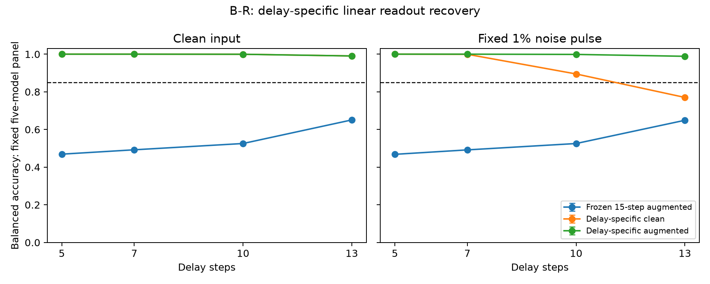

# B-R 实验结案：专用线性读出可恢复失败时长的任务表现

2026-09-24。**H-BR1 在预定范围内获得支持，全部质量门槛通过，首轮后结案。**

保持五个既有核心不变，为5、7、10、13步分别拟合线性读出后，四个时长在无噪和原1%噪声条件下均恢复到有用水平。新专用增强头八项主指标的99.375%双侧 t 区间下界全部超过85%，最低为98.828%。这与 B-T 的结论一致：旧15步头迁移失败，并不意味着这些时长的状态无法被线性读出有效利用。

本轮使用按时长选择的不同头，**没有验证一个共享头能够跨时长工作**。专用读出具有多组参数与时长条件资源，不能当作时间通用方法。

## 主要结果

下表为20个新测试库上五个固定模型集合的平均平衡准确率（BA）。干净条件评价一次；有噪条件先在每模型内平均10个噪声重复，再平均五模型，最后以20个库为统计单位。

| 延迟 | 专用增强头／无噪 | 专用增强头／有噪 | 该时长两条件中较低的主区间下界 |
|---|---:|---:|---:|
| 5 | 100.000% | 100.000% | 100.000% |
| 7 | 99.999% | 99.998% | 99.995% |
| 10 | 99.947% | 99.869% | 99.853% |
| 13 | 99.047% | 98.870% | 98.828% |

八项各使用99.375%双侧 t 区间，以Bonferroni控制合计错误额度5%，依赖库级抽样与 t 近似。推断条件化于五核心、此次拟合／验证库及最终选定的头，不包括重新拟合或新核心种子的不确定性。

5步全部测试观测正确导致库间方差为零，t 区间退化；7步未截断区间上界略超过100%。这些是预定近似公式在天花板附近的表现，不是总体准确率恰为100%或超过100%的证据。原始区间完整保留在 [数值结果](FULL_RESULTS.md) 和 [机器汇总](../../artifacts/branch_br/round1/summary.json)，未据结果更换统计方法。

同一批新测试图像上的旧15步增强头仅有46.809%–65.078%的集合平均 BA，复现迁移失败。专用增强头相对旧头的配对改进为33.968–53.191个百分点；这次比较无需跨旧、新测试库拼接数据。

专用干净头在干净输入下为99.047%–100.000%，说明无噪任务表现本身可以通过读出重拟合恢复。其有噪表现到10步降为89.489%、13步降为77.029%；增强训练对应达到99.869%、98.870%，分别高10.380、21.840个百分点。上述配对差异是预定次要描述，不是噪声增强必要性或唯一机制的新确认性检验。

五模型各自在八项主要条件中的增强头最低观测均值为：301 **99.974%**，302 **99.898%**，303 **98.694%**，304 **95.846%**，305 **99.443%**。没有剔除模型；主区间针对集合，不能把这些单模型点估计当作已完成的个体或种子群体推断。全部三种头的120个单模型主条件成绩见 [完整结果](FULL_RESULTS.md)。

## 拟合、数据隔离和审计

- **训练先于测试**：先生成独立拟合／验证库（seed 930001、930002；各5,000张图像，分别8,000／2,000个试次），完成40个头、200个候选及独立拟合审计后冻结。随后才生成20个测试库（seed 930100–930119；每库1,000图像、2,000试次）。文件时间与冻结记录也通过顺序核对。
- **数据质量**：30,000张本轮图像相互无像素重复，且与 B、B-N、B-T 共70,000张历史图像无重复。数量连通分量、全部数量对频数、标签与数量边际平衡、同试次图像不同均通过。
- **有效权重一致**：干净头每原试次权重1；增强头干净版本0.5、四个噪声版本各0.125，总权重仍为1。两个新头实际共享对应时长在干净拟合末状态上拟合的同一个scaler。不同专用时长有自己的scaler，不伪称资源等同于旧单头。
- **收敛与选择**：200候选均通过预定Newton求解与梯度门槛；独立重算所有候选的加权验证损失、选择结果、scaler来源及梯度。最大梯度∞范数为8.406×10⁻⁸，低于10⁻⁶。40头均选C=100；处于预定网格上边界已如实记录，没有扩网格或继续调参。所有候选参数和损失均留存。
- **冻结**：核心全部参数与归一化统计、旧头的内存及磁盘检查通过；新头冻结后预测阶段禁止拟合，参数与scaler前后相同。噪声标准差沿用每模型 B-N 的绝对单位，未按新时长重定标。
- **完整矩阵**：5核心×20测试库×5评价时长，共500个存储单元。四主要时长包含三种头，15步只有原增强头作锚点；所有干净预测、10个噪声重复、原任务头、重置及置换对照均保存。
- **独立预测复核**：重新构造全部噪声重复及4步测试续算，核对14,300组读出预测、原任务头预测、清零预测、64次标签置换及64次测试数量内状态行置换；全量通过。审计复用同一模型定义和视觉缓存函数，不宣称完全独立的软件实现。
- **实现核对**：拟合／验证及测试的各时长抽查32试次，像素／缓存前向、测试前索引、零扰动续算、清零续算均通过。25项测试通过，无未解决数值异常，无科学配置修复或第二轮。

## 正负对照

原15步增强头的无噪／有噪集合均值为97.830%／97.069%，区间下界97.754%／96.998%，均超过90%正对照门槛。原核心原任务头5步无噪／有噪观测均为100%，通过同一检查；其退化区间不代表总体无误差。

四主要时长、三种头、两输入条件的清零、标签置换、状态错配总体均值范围为49.951%–50.013%，全部满足47%–53%的校准门槛。带噪置换采用重复0，清零对照在清零后施加相同定义的噪声。该检查不是统计等效证明。

## 为什么在首轮停止

预定 H-BR1 要求专用增强头在全部八项条件达到85%的集合平均功能门槛。全矩阵和质量审计完成后，八项主区间下界全部满足要求，因此已获得支持。无需增加轮次或继续调参来重复展示成功。停止依据是限定假设获支持，不是时间、预算、轮数或低价值猜测。

当前证据说明**读出层面的重新拟合足以修复这些固定条件下的行为表现**；它不证明旧头失效的唯一机制，不证明所有模型或所有时长都能恢复，也不消除合成圆点任务的感知捷径问题。

若另立下一分支，值得优先研究：这些已确认存在的条件专用能力，能否压缩为每模型一个跨时长共享读出，并在未用于该头开发的时长上保持干净及有噪功能。本轮并未训练共享头或评价额外时长；新分支的训练／验证／留出时长、总权重、共享标准化和判据须另行登记。本轮结果还要求保留共享干净训练参照，以区分时间兼容与噪声稳健的作用。

## 归档和复现

- [执行前协议](../../artifacts/branch_br/round1/protocol.md)、[执行细节](../../artifacts/branch_br/round1/execution_details.md)、[停止决定](../../docs/decisions/branch_br/BR001_STOP.md)
- [训练审计](../../artifacts/branch_br/round1/training_audit.json)、[预测审计](../../artifacts/branch_br/round1/independent_audit.json)、[数据清单](../../artifacts/branch_br/round1/data_manifest.json)、[冻结清单](../../artifacts/branch_br/round1/training_lock.json)
- [最终文件哈希清单](../../artifacts/branch_br/reproducibility_manifest.json)。旧 B 118文件、B-N 218文件、B-T 601文件的归档清单均核对无修改。

在项目根目录的 `.venv` 环境中，`scripts/branch_br_audit.py evaluation` 可对现存输出重新审计；`scripts/branch_br_analyze.py` 和 `scripts/branch_br_report.py` 可重建数值汇总、表格和图。训练审计要求测试库尚未生成，以执行阶段隔离；如需全流程重跑应在独立目录副本中按 prepare → train（301–305）→ training审计 → lock → prepare_test → evaluate（301–305）→ evaluation审计 → analyze/report 的顺序执行。不要覆盖本次归档。环境、候选参数、源码快照和全部原始预测均已保留。
