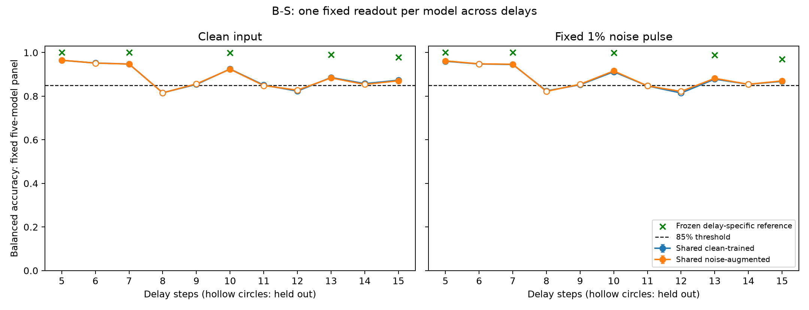

# B-S 实验结案：共享读出保持拟合时长功能，但部分留出时长失败

2026-09-25。**H-BS1 在预定范围内被证伪，全部质量门槛通过，首轮后结案。**

每模型只使用一个固定的增强线性读出和一个共享scaler时，5、7、10、13、15步的十项已拟合时长条件全部满足85%的集合平均功能要求；但留出的8、11、12步在干净和原1%噪声下都失败。六项失败的主区间上界均低于85%。因此，该具体共享训练流程未达到5–15步全部整数时长的完整功能要求。

22项主条件中，16项区间下界超过85%，6项区间上界低于85%，没有未决项。本次失败发生在留出条件，不能误写成已拟合时长的集合功能保持失败，也不能扩大为“任何共享线性读出都不可能成功”。

## 结果与统计判据

以下为增强共享头在五个固定核心集合上的平均平衡准确率（BA）。每库先平均每模型的10个噪声重复，再平均五模型，最后以20个独立测试库为统计单位。干净条件仅评价一次。

| 时长 | 角色 | 无噪BA | 原1%噪声BA | 两条件的主判据 |
|---|---|---:|---:|---|
| 5 | 拟合 | 96.514% | 96.202% | 均通过 |
| 6 | 留出 | 95.180% | 94.830% | 均通过 |
| 7 | 拟合 | 94.736% | 94.654% | 均通过 |
| 8 | 留出 | 81.531% | 82.210% | 均失败 |
| 9 | 留出 | 85.645% | 85.473% | 均通过 |
| 10 | 拟合 | 92.381% | 91.579% | 均通过 |
| 11 | 留出 | 84.873% | 84.717% | 均失败 |
| 12 | 留出 | 82.772% | 82.195% | 均失败 |
| 13 | 拟合 | 88.393% | 88.183% | 均通过 |
| 14 | 留出 | 85.411% | 85.460% | 均通过 |
| 15 | 拟合 | 87.071% | 87.022% | 均通过 |

每项主区间为 **99.772727…%双侧 t 区间**，即α=0.05/22，Bonferroni合计错误额度5%，依赖库级抽样与 t 近似。失败条件的完整区间为：

| 留出时长 | 无噪区间 | 有噪区间 |
|---|---|---|
| 8 | [81.400%, 81.663%] | [82.095%, 82.325%] |
| 11 | [84.771%, 84.974%] | [84.613%, 84.821%] |
| 12 | [82.622%, 82.922%] | [82.082%, 82.308%] |

11步无噪上界接近但仍低于预定85%阈值，按原判据列为失败；即使不依赖这个接近阈值的条件，8、12步也已明确触发整项假设的排除条件。未追加样本或更换统计方法。

图中空心点为留出时长，虚线为85%门槛，绿色叉号为已有专用增强头在对应时长的正对照。完整区间、220个单模型×时长×两头×两输入条件成绩、全部正负对照及逐时长拟合诊断见 [完整结果](FULL_RESULTS.md)。

## 共享干净头与专用头参照

共享干净头在8、12步也未达到85%的集合平均点估计。两共享头的配对差异范围为−0.339至+0.722个百分点，增强没有消除本轮的主要留出缺口。这只是预定次要描述，不构成噪声增强无效或等效的统计结论。

冻结专用增强头在五个对应时长的功能复现：5、7步接近或达到观测100%，10步无噪／有噪99.951%／99.863%，13步99.022%／98.849%，15步97.812%／97.044%。所有正对照区间下界都超过90%，最低96.951%；原核心原任务头5步两条件观测均100%，也通过质量检查。

这些参考头使用多套参数及按时长选择，并来自不同历史拟合库，不是资源完全匹配的共享方法竞争者。主方法在全部时长上确实固定同一组系数、截距与scaler，没有借用参考头输出或按时长校准。

单模型差异不可忽略：301–305的增强共享头在22条件中的最低观测均值分别为66.264%、77.874%、84.643%、75.798%、70.438%。主区间只针对五模型集合，不能把集合通过的时长描述为所有个体都通过，也不能把这些个体点估计当作已完成的个体假设检验。

## 执行与质量审计

- **数据与时长隔离**：拟合库seed 940001、验证库940002，分别8,000／2,000个平衡试次；每库5,000张图像。只提取5、7、10、13、15步用于拟合和验证。10个新头及50候选审计冻结后，才生成seed 940100–940119的20个测试库，每库1,000图像、2,000试次，随后评价六个留出时长。
- **数据质量**：本轮30,000张图像互不重复，并与 B、B-N、B-T、B-R 共100,000张历史图像无像素重复。连通分量数量、各数量对频数、标签平衡、数量边际、同试次图像不同均通过。
- **共享及权重**：每模型两个新头共享同一scaler，在五时长的干净拟合状态合并矩阵上拟合。干净头每时长每原试次权重0.2；增强头对应干净版本0.1、每个噪声版本0.025，跨五时长总权重均为1，总拟合权重8,000。分别审计跨时长与跨噪声副本权重；没有用状态副本数量放大有效样本或正则化尺度。
- **优化与选择**：50候选全部收敛；独立重算所有验证损失、选定C及梯度，最大梯度∞范数8.971×10⁻⁸，低于10⁻⁶。十个头均选择预定网格上界C=100，已完整记录，未扩展网格。每时长训练／验证诊断保留，但只用预定五时长平均验证损失选参。
- **冻结与完整矩阵**：所有核心及参考头始终冻结；共享scaler与新头在测试前冻结，测试阶段禁止拟合。每个时长核对新头及scaler对象一致，内存及磁盘哈希通过。五模型×20库×11时长的1,100单元全部完成，未删掉任何低表现条件。
- **预测复核**：重新构造全部噪声重复及4步续算，核对29,700组读出预测、原任务头、清零预测、64次标签置换及64次test数量内状态行置换。全部通过；审计复用同一模型定义及视觉缓存函数，不宣称完全独立的软件实现。
- **负对照**：两共享头全时长和五参考头对应时长的各负对照总体均值范围为49.903%–50.038%，全部满足47%–53%的流程校准门槛。噪声置换用rep=0，噪声清零先清零再加噪声。这不是等效性检验。
- **实现与历史完整性**：允许阶段的各模型／库／时长前32试次的像素／缓存前向、状态索引、零扰动续算和清零续算检查通过。28项测试通过，无计算修复。旧 B 118、B-N 218、B-T 601、B-R 705文件清单均保持无修改。
- **资源**：每计算进程1线程，最多2个并行，首个模型峰值内存约775 MiB，五模型最高约777 MiB。没有因资源调整数据、权重或目标。

区间及质量判断条件化于这五个核心、一次拟合／验证数据和最终头，不覆盖重新拟合或新核心种子的变异。正对照在天花板附近可能出现退化或轻微越界 t 区间，均原样留存，不解释为总体准确率已被证明恰好100%。

## 停止决定及剩余问题

首轮完整矩阵及全部质量门槛通过后，六项主区间上界低于85%，已经满足预先规定的 H-BS1 排除条件。故本分支首轮后结案，无需继续调参或增加轮次；停止依据是限定证伪，不是运行时间、预算、暂时不显著或低价值推测。

证据支持的描述是：**这个具体共享拟合流程能保持已拟合时长的集合功能，却没有在全部留出时长上实现所需插值能力。**它不证明共享线性边界数学上不存在，也不证明失败时长丢失了记忆信息。

尚未区分的是：8、11、12步的局部线性可读性是否同样可恢复；共享训练时长覆盖、正则化或平均损失选择规则是否限制了表现。本轮没有在这些留出时长训练专用头，因此不能把 B-R 四个时长的局部成功直接推广到这些新失败位置。

若后续另立修复分支，应以这些具体失败位置为依据，先明确局部可读性与训练覆盖干预要区分的解释，再登记实验。5–15步全部整数时长的结果现已看过；以后把其中时长加入拟合，再用新图像确认，可以检验已知时长集合的功能恢复，但不能继续把它们称为未参与方法开发的“新时长”。本轮未启动此类修复、新核心复制或非线性读出实验。

结论仅适用于当前合成圆点、固定核心、有限整数时长和测试前一次性独立噪声；不涉及更长延迟、连续时间、其他外形或生物机制，历史感知捷径问题仍在。

## 复现入口

- [执行前协议](../../artifacts/branch_bs/round1/protocol.md)、[执行细节](../../artifacts/branch_bs/round1/execution_details.md)、[停止决定](../../docs/decisions/branch_bs/BS001_STOP.md)
- [训练审计](../../artifacts/branch_bs/round1/training_audit.json)、[预测审计](../../artifacts/branch_bs/round1/independent_audit.json)、[时间顺序审计](../../artifacts/branch_bs/round1/chronology_audit.json)、[数据清单](../../artifacts/branch_bs/round1/data_manifest.json)
- [机器汇总](../../artifacts/branch_bs/round1/summary.json)、[冻结清单](../../artifacts/branch_bs/round1/training_lock.json)、[最终文件哈希清单](../../artifacts/branch_bs/reproducibility_manifest.json)

项目根目录的 `.venv` 环境中，`scripts/branch_bs_audit.py evaluation` 可复核现存原始结果；`scripts/branch_bs_analyze.py` 与 `scripts/branch_bs_report.py` 重建汇总、表格和图。全流程重跑须使用独立目录副本，依 prepare → train（301–305）→ training审计 → lock → prepare_test → evaluate（301–305）→ evaluation审计 → analyze/report 执行，避免覆盖本次归档。源码、环境、全部候选、预测和失败记录均留存。
