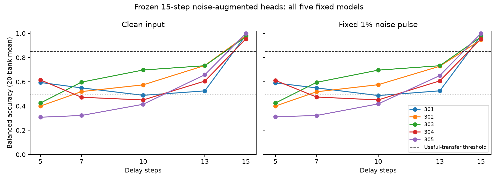

# B-T 实验结案：已有抗噪读出不具备预定跨时长功能

2026-09-24。**H-BT1 在预先指定范围内被证伪；质量审计通过，首轮后结案。**

15步拟合的 B-N 抗噪读出在原15步任务上仍有效，但原样用于5、7、10、13步时未达到预定85%集合平均平衡准确率（BA）要求。八项主要条件的99.375%双侧区间上界全部低于85%；无需增加轮次即可按原协议停止。本次没有重新训练核心或读出，没有依结果删除时长、模型或扰动条件。

## 结果

下表是五个固定模型集合的平均 BA；每条件先在模型内平均10次噪声重复，再平均五模型，最后以20个新图像库为推断单位。干净条件仅评价一次。

| 延迟 | 无噪声 | 原定义1%噪声 |
|---|---:|---:|
| 5 | 46.856% [46.811, 46.901] | 46.789% [46.740, 46.838] |
| 7 | 49.234% [49.152, 49.317] | 49.195% [49.120, 49.271] |
| 10 | 52.528% [52.473, 52.582] | 52.550% [52.488, 52.613] |
| 13 | 65.138% [65.005, 65.270] | 64.938% [64.845, 65.031] |
| 15（锚点） | 97.850% [97.785, 97.916] | 97.040% [96.976, 97.103] |

区间单位均为百分比。八项主比较各使用99.375%双侧 t 区间，Bonferroni 合计覆盖至少95%，依赖相应抽样和近似假设。15步为流程正对照，未纳入八项迁移要求。最高的主要区间上界仅65.270%，因此停止依据是明确违反功能判据，而非暂时不显著、运行时长或实验价值猜测。

全部单模型、两种头、两种扰动条件及配对差异见 [完整数值表](FULL_RESULTS.md)。五模型在八项主条件中的增强头最低 BA 分别为48.679%、40.000%、42.517%、45.035%、30.775%。单模型曲线并非都随时长单调变化，不能把集合曲线外推成连续时间保证。低于机会水平也不能证明状态不含任务信息；固定决策边界错配可能产生系统性错误，本轮未拟合新头以区分原因。

干净训练头在新时长上同样未达到85%的集合平均要求。增强头在13步有噪条件下比它高5.937个百分点，但绝对表现只有64.938%，不构成功能通过；15步有噪优势为23.737个百分点。上述差异为预定次要描述，未作新的确认性机制推断。

## 完整性与质量门槛

- 20个新图像库，seed 920100–920119，每库1,000张图像、2,000个平衡试次；图像数量核验、标签及数量边际平衡、同试次图像不同均通过。20,000张新图像相互不重复，且与 B 四库及 B-N 二十二库的50,000张历史图像无像素重复。
- 5模型 × 20库 × 5时长 = 500个完整存储单元，每单元保留两个头的干净预测、10次噪声预测及对照。全部矩阵完成后才裁决；无计算失败或修复轮次。
- 正对照：15步增强头无噪／有噪区间下界97.785%／96.976%，均超过90%；原模型原任务头在5步无噪／有噪的观测值均为100%，通过同一门槛。后两项的 t 区间因库间样本方差为零而退化为[100%,100%]，不代表总体准确率已被证明恰好为100%。原任务头仅作正对照，未用于替换主读出。
- 两个冻结头在每个主要时长及扰动条件下的清零、64次标签置换、64次测试数量内状态行置换总体均值均在49.990%–50.085%，满足预定47%–53%的流程校准范围。噪声置换使用重复0；清零后再施加噪声。该校准不是统计等效结论。
- 每库每模型每时长抽查32试次的像素／缓存前向、测试前索引、零扰动续算、清零续算，均在预先固定容差内一致。
- 运行时禁止拟合；模型全部参数和归一化统计、读出及标准化参数的内存前后快照一致，源文件磁盘哈希一致。
- 独立复核全部500单元评分和随机置换索引，重新构造所有噪声重复，核对11,000组头预测及原任务头预测，重新计算清零对照，全部通过。此复核重新实现噪声续算，但复用同一模型定义及视觉缓存函数，不宣称完全独立的软件实现。
- 22项测试通过；B 历史清单118文件和 B-N 历史清单218文件均无修改。

## 停止边界与后续意义

本次停止的是已登记的 H-BT1：这些固定15步增强头是否能直接满足四个新延迟、两种条件下的全部功能要求。质量通过且八项均明确失败，因此无需第二轮来重复证伪。没有以“实验价值极低”替代证据，也没有扩大为“任何共享读出都不可能成功”。

原15步任务的抗噪成功不能自动组合成时间泛化能力。当前结果与时间相关状态／读出边界错配相容，但并未定位其唯一原因。若后续另立修复分支，应依据这次多个新时长都失败、原任务对照正常的结果，先检查失败时长的条件专用线性头能否读出信息，再判断是否值得拟合多时长共享头并做新时长留出。该方向尚未执行，不属于本轮结论。

全部推断只针对五个既有固定核心、既有冻结头、合成圆点输入与测试前一次性噪声脉冲；不涵盖新核心训练种子、其他外形、连续时长、持续噪声或生物机制。历史感知捷径问题仍然存在。

## 复现入口

- [原始首轮协议](../../artifacts/branch_bt/round1/protocol.md) 与 [预先固定的执行细节](../../artifacts/branch_bt/round1/execution_details.md)
- [停止决定](../../docs/decisions/branch_bt/BT001_STOP.md)
- [机器可读汇总](../../artifacts/branch_bt/round1/summary.json)、[原始预测复核](../../artifacts/branch_bt/round1/independent_audit.json)、[数据清单](../../artifacts/branch_bt/round1/data_manifest.json)
- [最终文件哈希清单](../../artifacts/branch_bt/reproducibility_manifest.json)；所有原始输出位于 `artifacts/branch_bt/round1/seed301` 至 `seed305`，不覆盖旧分支产物。

在项目根目录使用 `.venv` 环境运行 `scripts/branch_bt_analyze.py` 可复核现存原始输出并重新汇总；运行 `scripts/branch_bt_report.py` 可重建表格与图片。正式实验脚本 `scripts/branch_bt_round1.py` 分别接受 `--prepare` 与 `--seed 301`（至305）；复现实验应使用另一个目录副本，避免覆盖已归档数据。环境版本见 `artifacts/branch_bt/round1/environment.json`，源码另行打包留存。
