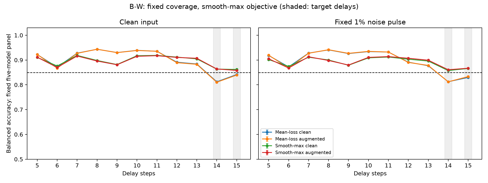

# B-W结案：全时长平均功能过线，但15步无噪增益未达预定门槛

2026-09-25。**H-BW1被限定排除；全部质量门槛通过，按预定判据结案。**

**主要发现：固定五模型平均的22项绝对功能全部获得>85%的支持；14步无噪／有噪和15步有噪三项增益超过2个百分点。15步无噪增益为1.883个百分点，校正区间[1.787, 1.979]，未达到预定>2个百分点要求，因此严格合取假设仍被排除。**
26项主要要求：25项支持、1项排除、0项未决。绝对功能22项：22支持／0排除／0未决；配对增益4项：3支持／1排除／0未决。

## 实验设计

B-C的缺口位于14、15步。本轮冻结五个核心，保持八时长拟合／验证覆盖[5,7,8,10,11,12,13,15]，比较平均时长对数损失与固定tau=0.05的平滑最大时长损失。各有干净／噪声增强版本，共20个新共享线性头、100个候选。四方法共享相同scaler来源、基础权重、C网格和求解器；均以八时长验证损失的最大值选C。14步未参与本轮拟合或验证。

平滑最大目标是有限温度的损失折中，不是精确minimax，也不直接优化最差准确率。mean为本轮匹配基线，不是历史B-C的逐字复制。C可随目标改变，结论针对完整预定流程。

成功要求worst_aug在5–15步干净／有噪22条件全部BA>85%，并在14、15步四条件相对mean_aug全部提升>2个百分点。每项使用99.80769231%双侧t区间、df=19，26项Bonferroni联合错误额度5%。先在模型内平均噪声重复，再平均固定五模型，以20个新测试库为推断单位。任一要求上界低于门槛即可排除该合取假设。

## 全时长结果

表中两方法均为噪声增强头；无噪／有噪指测试输入条件。BA以百分比表示。

| 时长 | 平均目标无噪 | 最差目标无噪 | 平均目标有噪 | 最差目标有噪 | 最差−平均，无噪／有噪（百分点） |
|---|---:|---:|---:|---:|---:|
| 5 | 92.225% | 91.116% | 91.935% | 90.503% | -1.108／-1.431 |
| 6 | 86.729% | 87.020% | 86.793% | 86.777% | +0.291／-0.017 |
| 7 | 92.707% | 91.625% | 92.736% | 91.310% | -1.082／-1.425 |
| 8 | 94.345% | 89.595% | 94.151% | 89.812% | -4.750／-4.338 |
| 9 | 92.987% | 88.097% | 92.694% | 87.973% | -4.890／-4.720 |
| 10 | 93.847% | 91.502% | 93.490% | 91.061% | -2.345／-2.429 |
| 11 | 93.522% | 91.748% | 93.228% | 91.389% | -1.774／-1.839 |
| 12 | 88.934% | 91.050% | 89.032% | 90.717% | +2.116／+1.685 |
| 13 | 88.272% | 90.704% | 87.827% | 89.929% | +2.432／+2.102 |
| 14 | 81.049% | 86.389% | 81.223% | 86.089% | +5.340／+4.865 |
| 15 | 83.932% | 85.815% | 83.322% | 86.691% | +1.883／+3.368 |

## 四项预定配对改善

| 指标 | 增益（百分点） | 校正区间 | >2个百分点 |
|---|---:|---|---|
| gain_d14_clean | +5.340 | [5.200, 5.480] | 支持 |
| gain_d14_noise | +4.866 | [4.802, 4.929] | 支持 |
| gain_d15_clean | +1.883 | [1.787, 1.979] | 排除 |
| gain_d15_noise | +3.368 | [3.292, 3.445] | 支持 |

## 未满足或未决的要求

| 指标 | 均值 | 校正区间 | 门槛 | 裁决 |
|---|---:|---|---:|---|
| gain_d15_clean | 1.883 | [1.787, 1.979] | 2.0 | 排除 |

绝对功能以百分比表示，增益以百分点表示。不满足预定2个百分点门槛不等于完全没有改善。全部26项区间、四方法与440个单模型成绩见[完整结果](FULL_RESULTS.md)。

各模型worst_aug在22条件中的最低均值：301：76.150%；302：77.940%；303：85.738%；304：79.768%；305：78.035%。集合判据不代表每个模型均满足门槛。

## 拟合诊断

以下为选定增强头的描述性诊断，干净／噪声各半，不新增确认性检验。

| 头 | 时长 | 训练BA | 验证BA |
|---|---|---:|---:|
| mean_aug | 5 | 92.066% | 92.094% |
| mean_aug | 7 | 92.763% | 92.670% |
| mean_aug | 8 | 94.211% | 94.239% |
| mean_aug | 10 | 93.625% | 93.529% |
| mean_aug | 11 | 93.352% | 93.275% |
| mean_aug | 12 | 88.948% | 89.114% |
| mean_aug | 13 | 88.157% | 87.854% |
| mean_aug | 15 | 83.641% | 83.749% |
| worst_aug | 5 | 90.837% | 90.817% |
| worst_aug | 7 | 91.447% | 91.310% |
| worst_aug | 8 | 89.688% | 89.681% |
| worst_aug | 10 | 91.210% | 91.125% |
| worst_aug | 11 | 91.466% | 91.404% |
| worst_aug | 12 | 90.856% | 90.715% |
| worst_aug | 13 | 90.451% | 90.340% |
| worst_aug | 15 | 86.362% | 86.430% |

选定C（模型301→305）：

- mean_clean: 100.0, 0.1, 100.0, 100.0, 100.0
- mean_aug: 100.0, 0.1, 100.0, 100.0, 100.0
- worst_clean: 100.0, 100.0, 100.0, 100.0, 100.0
- worst_aug: 100.0, 100.0, 100.0, 100.0, 100.0

## 最差目标的实际梯度权重

训练的基础时长权重仍相等；下表是选定worst_aug最终损失对应的softmax梯度权重，顺序与拟合时长一致。不是额外手工加权。

| 模型 | 5 | 7 | 8 | 10 | 11 | 12 | 13 | 15 |
|---|---:|---:|---:|---:|---:|---:|---:|---:|
| 301 | 0.043 | 0.067 | 0.084 | 0.111 | 0.076 | 0.115 | 0.166 | 0.339 |
| 302 | 0.079 | 0.045 | 0.055 | 0.104 | 0.053 | 0.071 | 0.095 | 0.498 |
| 303 | 0.169 | 0.110 | 0.071 | 0.077 | 0.092 | 0.127 | 0.244 | 0.111 |
| 304 | 0.029 | 0.113 | 0.119 | 0.055 | 0.072 | 0.142 | 0.211 | 0.258 |
| 305 | 0.025 | 0.089 | 0.124 | 0.164 | 0.069 | 0.221 | 0.123 | 0.185 |

## 审计与复现

- 100候选的目标、组损失、梯度、自适应权重及最大验证损失选参均独立复核。最大梯度∞范数9.67e-08，低于1e-6。
- 拟合／验证各5,000张图像；冻结20头后生成20个测试库各1,000张。本轮30,000张相互无像素重复，并与B至B-C的190,000张及A显式库4,000张核查无重复；不涵盖未留存在线图像。
- 完成1,100个模型×库×时长单元，独立重建全部噪声重复和续算，核对57,200组线性头预测、原任务头及负对照。审计复用模型定义，不是完全独立的软件实现。
- 专用参照及原任务头正对照全部通过，最低区间下界96.941%。负对照均值范围49.965%–50.067%，在47%–53%校准门槛内；这不是等效检验。
- 55项实现／回归测试通过；26项终点另行逐单元重算区间并交叉核对。最初两处测试引用旧分支别名的问题已在生成数据前修复并保留失败日志，不是科学拟合失败。
- 训练、冻结、测试顺序，核心与读出冻结，历史科学产物完整性全部通过。科学执行代码自归档起未改变；最多两个计算进程，每进程一线程。

## 解释边界与停止

本结论条件化于固定五核心和本次拟合／验证数据，不覆盖新核心或重拟合不确定性。所有测试时长均为历史已知条件；6、9、14步仅未参与本轮拟合，不能称为从未参与方法开发的新时长。未截断的t区间在天花板处退化或越界不证明总体无误差。

按预定支持／排除判据结案，不据结果追加温度或C调参。具体有限温度流程的结果不证明共享线性边界不存在，也不排除其他最差损失目标。专用参照有多套参数与时长条件资源，不能当成资源相同的方法。

## 结果意味着什么、下一步优先问题

目标改变明显调整了跨时长权衡：14、15步均值功能改善，但8、9步无噪均值分别下降4.750、4.890个百分点；本轮85%绝对门槛不要求所有位置不降分。15步训练／验证混合BA从83.641%／83.749%提高到86.362%／86.430%，提示改善已出现在拟合与验证分布上；这不能排除C选择变化的贡献。

全时长过线是固定五模型平均的结论。五个模型中四个仍有低于85%的条件，最低观测均值分别约76.15%、77.94%、85.74%、79.77%、78.04%。不能称为每个模型都获得通用读出。

后续优先保持当前目标、温度、覆盖与选参规则，另行预注册独立拟合／验证数据的重复实验，检查平均功能改善能否重现，以及各模型薄弱时长是否稳定。应把跨重拟合稳定性与单模型最差条件分别列为新问题，不能沿用本轮跨测试库区间来代表重拟合不确定性。更换核心的外部验证可作为随后独立问题。当前不为追过2个百分点门槛追加温度搜索，也不同时加入14步；这些均会开启不同干预。此处为下一问题建议，尚未执行。

## 材料

- [执行前协议](../../artifacts/branch_bw/round1/protocol.md)、[完整数值](FULL_RESULTS.md)、[停止决定](../../docs/decisions/branch_bw/BW001_STOP.md)
- [机器汇总](../../artifacts/branch_bw/round1/summary.json)、[训练审计](../../artifacts/branch_bw/round1/training_audit.json)、[预测审计](../../artifacts/branch_bw/round1/independent_audit.json)、[数据与顺序审计](../../artifacts/branch_bw/round1/data_chronology_integrity.json)
- [哈希清单](../../artifacts/branch_bw/reproducibility_manifest.json)

按prepare→train(301–305)→training审计→lock→prepare_test→evaluate(301–305)→evaluation及integrity审计→analyze→crosscheck→report→finalize顺序复现；使用独立空输出目录，避免覆盖本轮归档。
