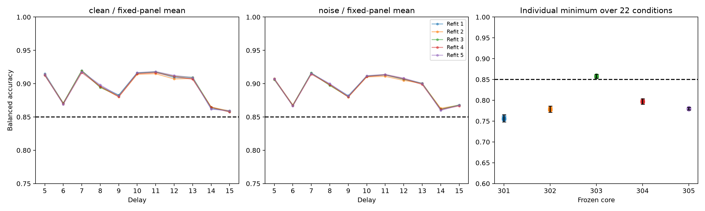

# B-Z：平均功能可重复，四个模型的个体短板持续存在

2026-09-25。全部5个独立批次完成，质量审计通过。

**平均功能假设：支持；个体最差表现假设：排除。**

本轮复用固定五核心与B-W增强流程，仅更换独立拟合、验证和测试数据；每批10头、50候选，合计50头、250候选。训练全部冻结后生成20个新测试库，共70,000新图像。未调整温度、时长覆盖或C网格。

统计单位为5个独立批次，每批含4库。以下27项区间为99.81481481%双侧t区间，df=4，联合Bonferroni5%。平均问题针对固定五核心的期望平均；个体问题针对每核心每批22条件的有限测试观测最小值之期望，存在取最小值的向下偏差。5批的正态近似和估计精度是限制。

**核心发现：独立更换5组拟合／验证／测试数据后，五模型平均的22项校正区间下界仍全部>85%，最低下界85.582%。但四个模型的期望观测最差表现区间上界仍<85%，只有303支持>85%；27项中23项支持、4项排除、0项未决。五个模型在全部5次重复中都保留了B-W的同一个最差条件。**

## 27项确认性结果

| 家族／条件 | 均值% | 校正区间% | 相对85% |
|---|---:|---|---|
| panel/d5_clean | 91.350 | [91.034, 91.666] | 支持 |
| panel/d5_noise | 90.690 | [90.496, 90.884] | 支持 |
| panel/d6_clean | 87.009 | [86.757, 87.262] | 支持 |
| panel/d6_noise | 86.719 | [86.517, 86.921] | 支持 |
| panel/d7_clean | 91.849 | [91.436, 92.263] | 支持 |
| panel/d7_noise | 91.537 | [91.310, 91.764] | 支持 |
| panel/d8_clean | 89.591 | [89.111, 90.071] | 支持 |
| panel/d8_noise | 89.857 | [89.528, 90.186] | 支持 |
| panel/d9_clean | 88.142 | [87.771, 88.514] | 支持 |
| panel/d9_noise | 88.074 | [87.807, 88.340] | 支持 |
| panel/d10_clean | 91.551 | [91.212, 91.890] | 支持 |
| panel/d10_noise | 91.105 | [90.874, 91.336] | 支持 |
| panel/d11_clean | 91.696 | [91.273, 92.119] | 支持 |
| panel/d11_noise | 91.290 | [90.924, 91.655] | 支持 |
| panel/d12_clean | 91.007 | [90.340, 91.673] | 支持 |
| panel/d12_noise | 90.678 | [90.268, 91.088] | 支持 |
| panel/d13_clean | 90.821 | [90.449, 91.193] | 支持 |
| panel/d13_noise | 90.003 | [89.765, 90.241] | 支持 |
| panel/d14_clean | 86.357 | [85.904, 86.810] | 支持 |
| panel/d14_noise | 86.134 | [85.748, 86.520] | 支持 |
| panel/d15_clean | 85.855 | [85.582, 86.127] | 支持 |
| panel/d15_noise | 86.753 | [86.560, 86.946] | 支持 |
| individual/301 | 75.680 | [74.827, 76.533] | 排除 |
| individual/302 | 77.862 | [77.113, 78.612] | 排除 |
| individual/303 | 85.765 | [85.296, 86.234] | 支持 |
| individual/304 | 79.725 | [79.096, 80.354] | 排除 |
| individual/305 | 77.993 | [77.672, 78.313] | 排除 |

## 目标时长增益：仅描述

这些未校正95%区间不构成新增确认性结论，也不改变B-W的>2个百分点判据和结案。

| 条件 | worst−mean，百分点 | 95%区间 | 五批增益 |
|---|---:|---|---|
| d14_clean | 5.213 | [5.040, 5.386] | 5.040, 5.237, 5.220, 5.420, 5.147 |
| d14_noise | 4.769 | [4.695, 4.843] | 4.757, 4.849, 4.740, 4.805, 4.694 |
| d15_clean | 2.165 | [1.974, 2.357] | 2.342, 2.255, 1.960, 2.060, 2.210 |
| d15_noise | 3.466 | [3.385, 3.548] | 3.565, 3.439, 3.414, 3.413, 3.500 |

## 个体薄弱条件稳定性

旧最差条件在B-W既有结果上固定。本轮排序为1最差，允许并列；全部为描述性诊断。

| 核心 | B-W最差条件 | 本轮同条件五批BA% | 五批排名 | 本轮五个最差条件 |
|---|---|---|---|---|
| 301 | d15/clean | 76.10, 75.67, 75.46, 75.46, 75.70 | [1, 1, 1, 1, 1] | d15/clean: 76.10%, d15/clean: 75.67%, d15/clean: 75.46%, d15/clean: 75.46%, d15/clean: 75.70% |
| 302 | d15/clean | 78.20, 78.00, 77.69, 77.74, 77.69 | [1, 1, 1, 1, 1] | d15/clean: 78.20%, d15/clean: 78.00%, d15/clean: 77.69%, d15/clean: 77.74%, d15/clean: 77.69% |
| 303 | d6/clean | 85.74, 85.69, 85.95, 85.86, 85.59 | [1, 1, 1, 1, 1] | d6/clean: 85.74%, d6/clean: 85.69%, d6/clean: 85.95%, d6/clean: 85.86%, d6/clean: 85.59% |
| 304 | d9/clean | 79.64, 79.76, 80.00, 79.75, 79.48 | [1, 1, 1, 1, 1] | d9/clean: 79.64%, d9/clean: 79.76%, d9/clean: 80.00%, d9/clean: 79.75%, d9/clean: 79.48% |
| 305 | d14/clean | 78.06, 78.12, 77.94, 77.95, 77.89 | [1, 1, 1, 1, 1] | d14/clean: 78.06%, d14/clean: 78.12%, d14/clean: 77.94%, d14/clean: 77.95%, d14/clean: 77.89% |

## 质量与执行

58项实现／回归测试通过。250候选全部独立重算组损失、目标、梯度、权重和选参；1,100测试单元、33,000组线性预测独立重算，包含全部噪声重复、清零、64次标签置换及64次分层错配。27项统计结果从原始单元再次独立聚合。审计复用模型定义，不是完全独立软件实现。

正对照每批平均最低96.919%，跨批校正区间下界最低96.813%；负对照范围49.838%–50.182%，在47%–53%流程门槛内。负对照通过不是等效证明。

新图像相互及相对224,000张历史留存图像无像素重复；未留存在线图像不在核查范围。所有50头先审计冻结，随后生成任何测试数据。最多两个进程，每进程一线程。历史科学产物未修改；当前规划入口原文单独归档。

## 科学解释与下一问题

平均功能恢复并非仅见于B-W的一次拟合；在本轮固定核心、生成分布与流程下具有可重复性。与此同时，个体薄弱点并未随独立重拟合消失。最差条件位置25/25次与B-W一致是描述性稳定性证据，不证明对所有可能重拟合或新核心都成立。

四个失败模型的短板可分为两类：301／302的15步已经参与训练；304的9步与305的14步未参与本轮训练。下一项机制实验应分别区分已训练时长的损失权衡与未拟合时长的覆盖问题，不能把两类失败都归因于采样波动，也不能据此宣布共享线性读出数学上不可能。后续干预须单独预注册；本轮没有执行额外温度、覆盖或特征搜索。

15步无噪的描述性配对增益为2.165个百分点，跨批未校正95%区间[1.974, 2.357]仍包含2个百分点。该描述性结果不改变B-W按原协议作出的严格增益结论，也不充当本轮新增确认性通过。

## 实现修正与复现

审计历史图像计数时补充排除了当前分支路径；原始审计源码保留。自动调度器首次调用审计时误将虚拟环境入口解析为系统Python，因缺少numpy未开始审计计算；修正后所有审计通过。原失败日志保留。两处修正均未改变已固定的数据、方法、样本数与统计判据，详见[实现记录](../../artifacts/branch_bz/implementation_notes.md)。

原执行代码、补充审计与调度代码的哈希分别归档。完整复现需在独立空输出位置按prepare(批次1–5)→train(全部25模型批次)→finish_execution（独立训练审计、全局冻结、测试生成、评价与审计、统计、图表）→interpret→finalize运行，避免覆盖现有产物。5批原始数据、全部候选及预测、环境版本、日志与源码快照均保留。

## 停止和边界

本轮按执行前固定的5批完成。任何未决项如实保留，不追加批次来改变显著性。本轮完成不等于所有科学问题已有确定答案。结论仍限于固定五核心和既定图像生成分布，不外推新核心；所有时长在历史开发中均已知。有限批次数无法可靠描述重拟合尾部失败概率。未截断t区间超出[0,1]不代表总体无误差。

[执行前协议](../../artifacts/branch_bz/protocol.md) · [全部批次与个体数值](FULL_RESULTS.md) · [机器汇总](../../artifacts/branch_bz/summary.json) · [完整性审计](../../artifacts/branch_bz/integrity.json) · [复现清单](../../artifacts/branch_bz/reproducibility_manifest.json)
